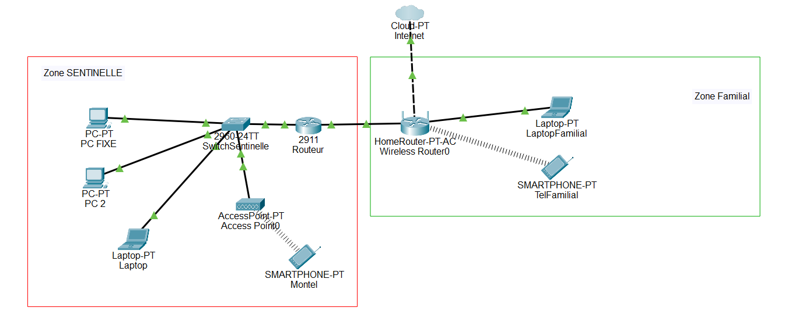

# Architecture

## Schéma

Maquette Packet Tracer : elle montre la structure (frontière, zones, flux). Elle ne montre ni la configuration des VLAN ni les règles, qui sont dans les autres fichiers.

> Le HomeRouter représente la box réelle (routeur Wi-Fi). Le routeur 2911 représente le routeur Sentinelle, frontière de la zone.

## Flux principaux

| Flux | De | Vers | Passe par |
|---|---|---|---|
| Internet entrant (VPN) | Internet | Vestibule (VPN, port redirigé par la box) | Box (redirection) → routeur Sentinelle |   
|Internet sortant | Zones | Internet | Routeur Sentinelle |
| Administration | Zone admin (10) | Routeur, serveur de services | Routeur Sentinelle |
| Invités | Salon (30) | Internet | Routeur Sentinelle |
| Maison | Réseau familial | Internet | Box (hors Sentinelle) |
> Seul flux entrant autorisé : le port VPN, redirigé par la box vers le vestibule. Tout autre port reste fermé. Détail des règles dans `05-regles.md`.

## Zones

| Zone | VLAN | Rôle | Contenu |
|---|---|---|---|
| Admin | 10 | Administration | PC fixe, Kali |
| Postes | 20 | Usage quotidien | PC portable, téléphone |
| Salon (invités gérés) | 30 | Invités, accès accordé par toi, surveillé | Appareils invités |
| Vestibule (DMZ) | À compléter | Services exposés | VPN, honeypot |
| Chambre forte | À compléter | Données et services critiques | SSO, Vaultwarden, Restic, Syslog, Grafana |
| Maison (hors Sentinelle) | aucun | Réseau familial, non géré | Appareils de la famille |

## Équipements

| Équipement | Rôle | Statut |
|---|---|---|
| Box internet | Liaison Internet, routeur (bridge envisagé) | ✅ |
| Routeur Sentinelle | Pare-feu, frontière, VLAN | À acheter |
| Switch manageable 8 ports | VLAN, trunk | À acheter |
| PC fixe (16 Go) | Zone admin, VM | ✅ |
| Vieux PC (8 Go) | Rôle à définir | À compléter |
